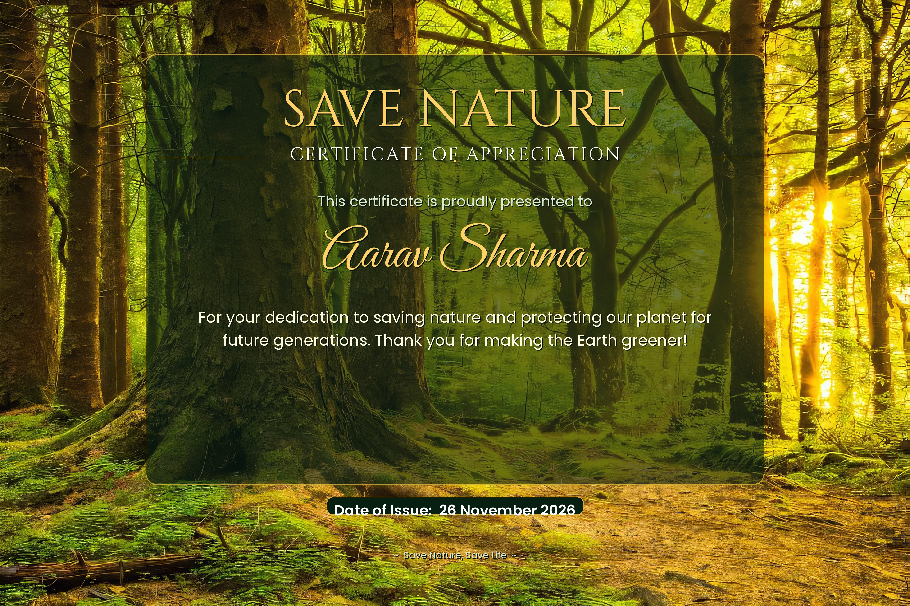

# 🌳 Save Nature Certificate Generator API

A Flask API that generates a **Save Nature** certificate. It draws the
**name**, **current date of issue**, and a **good message** onto the sunlit
forest template using Pillow — **no score required** — ready to deploy on
**Vercel** as a serverless Python function.



## Features

- ✅ Uses the uploaded forest template (`assets/certificate_template.jpg`, 3840×2560, optimised from 19 MB PNG)
- ✅ Inputs: `name` only — **without any score**, as requested
- ✅ Auto date of issue — today's date in Asia/Kolkata, e.g. `26 November 2026`
- ✅ Good message: *"For your dedication to saving nature and protecting our planet for future generations. Thank you for making the Earth greener!"* (customisable via `?message=...`)
- ✅ Dark-green panel + gold text for readability over the bright forest photo
- ✅ Returns **JPG by default** (this 4K photo template is ~18 MB as PNG — too large for Vercel; JPG is ~3 MB). PNG available via `?format=png`.
- ✅ CORS enabled, works from any frontend
- ✅ Vercel-ready (`vercel.json` + `api/index.py`, Framework Preset: **Flask**)

## Project structure

```
nature-certificate-api/
├── api/
│   └── index.py              # Flask app (Vercel entrypoint)
├── app.py                    # Local dev entrypoint
├── assets/
│   ├── certificate_template.jpg   # Forest template (optimised JPG)
│   └── fonts/                     # Cinzel, Great Vibes, Poppins, Montserrat
├── vercel.json               # Functions config only (NO rewrites — see deploy note)
├── requirements.txt
└── README.md
```

## API endpoints

| Method | URL | Description |
|---|---|---|
| GET | `/` | Landing page with a live generate form |
| GET | `/health` | Health check → `{"status": "ok"}` |
| GET | `/certificate?name=Aarav` | Certificate image (JPG by default) |
| GET | `/certificate/Aarav` | Same, via path param |
| POST | `/certificate` | JSON body `{"name":"Aarav"}` → image |
| GET/POST | `/api/certificate...` | Alias (same handlers) |

### Parameters

| Param | Required | Description |
|---|---|---|
| `name` | ✅ | Recipient's name, e.g. `Aarav Sharma` |
| `date` | optional | Override date of issue, e.g. `31 October 2026` |
| `message` | optional | Override the good message text |
| `format` | optional | `jpg` (default), `png`, or `json` (base64 response) |
| `download` | optional | `true` → download as file instead of inline preview |

> There is **no score parameter** for this certificate. If a `score` is
> passed it is simply ignored.

### Examples

```bash
# 1) Browser / img tag — JPG (default)
https://YOUR-PROJECT.vercel.app/certificate?name=Aarav%20Sharma

# 2) Path style
https://YOUR-PROJECT.vercel.app/certificate/Aarav%20Sharma

# 3) Download as file
https://YOUR-PROJECT.vercel.app/certificate?name=Aarav&download=true

# 4) Custom good message
https://YOUR-PROJECT.vercel.app/certificate?name=Aarav&message=Plant%20a%20tree%20today%2C%20save%20tomorrow!

# 5) POST JSON (returns image)
curl -X POST https://YOUR-PROJECT.vercel.app/certificate \
  -H "Content-Type: application/json" \
  -d '{"name":"Aarav Sharma"}' --output certificate.jpg

# 6) POST JSON → base64 (for apps that store the image)
curl -X POST https://YOUR-PROJECT.vercel.app/certificate \
  -H "Content-Type: application/json" \
  -d '{"name":"Aarav Sharma","format":"json"}'
```

### Frontend usage (JavaScript)

```html

<script>
  const name = "Aarav Sharma";
  document.getElementById("cert").src =
    `/certificate?name=${encodeURIComponent(name)}`;
</script>
```

## Run locally

```bash
pip install -r requirements.txt
python app.py
# open http://localhost:5000
```

## Deploy on Vercel

**Option A — Vercel CLI**

```bash
npm i -g vercel
vercel login
vercel        # follow prompts; framework: Flask
vercel --prod
```

**Option B — GitHub + Vercel dashboard**

1. Push this folder to a GitHub repo.
2. Go to [vercel.com/new](https://vercel.com/new) → import the repo.
3. Framework preset: **Flask** (important — not "Other").
4. Deploy — Vercel auto-detects the Flask app in `api/index.py` / `app.py`
   and routes every request to it with its original path.

> ⚠️ Do **not** add a catch-all rewrite (`/(.*)` → `/api/index.py`) to
> `vercel.json`. Vercel's Flask integration already routes all requests to
> Flask; a rewrite makes Flask receive `PATH_INFO=/api/index.py` for every
> request, which has no route — so every URL returns Flask's 404 page.
> The included `vercel.json` intentionally has **no rewrites**, only
> `functions` config to bundle `assets/**` (template + fonts) and set
> `maxDuration`.

## Customisation

- **Template:** replace `assets/certificate_template.jpg` with any image
  (keep the same filename; `.png` also works).
- **Good message:** edit `DEFAULT_MESSAGE` in `api/index.py`, or pass
  `?message=...` per request.
- **Fonts:** add/replace files in `assets/fonts/` and update `FONT_FILES`.
- **Text positions/colours:** edit `generate_certificate()` in `api/index.py`.
- **Date format:** change `current_date_str()` (currently `%d %B %Y`,
  Asia/Kolkata timezone).

## Notes

- JPG output uses quality 90 — fast (~0.3s) and ~3 MB at full 4K resolution.
  PNG at this resolution is ~18 MB and may exceed Vercel response limits.
- Long names automatically shrink to fit the certificate width.
- Missing `name` returns `400 {"error": "Missing required parameter: name"}`.
